# Testing: The Haunted Tavern

**Course:** CSC 4370, Project 1
**Team:** Joe Turner, Shozab Mirza
**Date tested:** October 19, 2026

We tested the website to make sure the pages and features work correctly.

## Tests included

- Navigation between all five pages
- Desktop and mobile layouts (we also checked a tablet size)
- Card hover effects
- High Card flipping
- Current-turn animation
- Keyboard navigation
- Reduced-motion support

All five HTML files passed W3C HTML validation without errors or warnings.

The CSS file also passed W3C CSS validation without errors or warnings.

## Screen sizes

We checked all 5 pages (Home, Lobby, Card Decks, Rules, Game Table) in Chrome:

| Device | Screen size |
|---|---|
| Mobile | 375 x 812 |
| Tablet | 768 x 1024 |
| Desktop | 1366 x 768 |

Screenshots of every page at every size are in the `evidence` folder.

## Results

| Test | Result |
|---|---|
| Navigation: all 34 links and `#` anchors work (nav, Learn More, View Table, Enter Game) | Pass |
| No sideways scrolling on any page at mobile, tablet or desktop | Pass |
| Mobile: game cards stack into one column | Pass |
| Mobile: player/turn panel becomes one column | Pass |
| Tablet and desktop: three game cards side by side | Pass |
| Card hover effect (lifts and grows) | Pass |
| High Card flip works with a click | Pass |
| High Card flip works with the keyboard (Space) | Pass |
| Current-turn glow animation runs | Pass |
| Keyboard navigation: Tab moves through the nav, then the cards, in order | Pass |
| Gold focus outline shows on cards | Pass |
| Text contrast is readable (lowest ratio is 5.36:1; 4.5:1 is the AA minimum) | Pass |
| Reduced-motion: hover and flip animations turn off | Pass |
| Reduced-motion: Current Turn glow turns off | **Not yet.** See known issues |

## Known issues

1. **Current Turn glow ignores "reduce motion."** The reduce-motion rule in `style.css` is placed before the rule that turns the glow on, so the glow rule wins. Moving the reduce-motion block to the bottom of the file fixes it.
2. **High Card flip looks flat.** Adding `perspective: 800px;` to `.deck` would give it depth.
3. **Only one breakpoint (600px).** Tablet uses the desktop layout. It looks fine but isn't tablet-specific.
4. **The "Clear Weather" card is faded on purpose** to show it has been used, so its text is low contrast by design.

## Still to test by hand

| Test | Who | Result | Date |
|---|---|---|---|
| Firefox, all 5 pages | | | |
| Real phone | | | |
| Live CODD site: every page loads and the CSS shows up | | | |

## Screenshots

In `evidence/`: `[page]-[mobile|tablet|desktop].png` for index, lobby, decks, rules and game, plus `highcard-flipped-desktop.png` (both High Card cards flipped).

Still needed: a screenshot of the live CODD site.

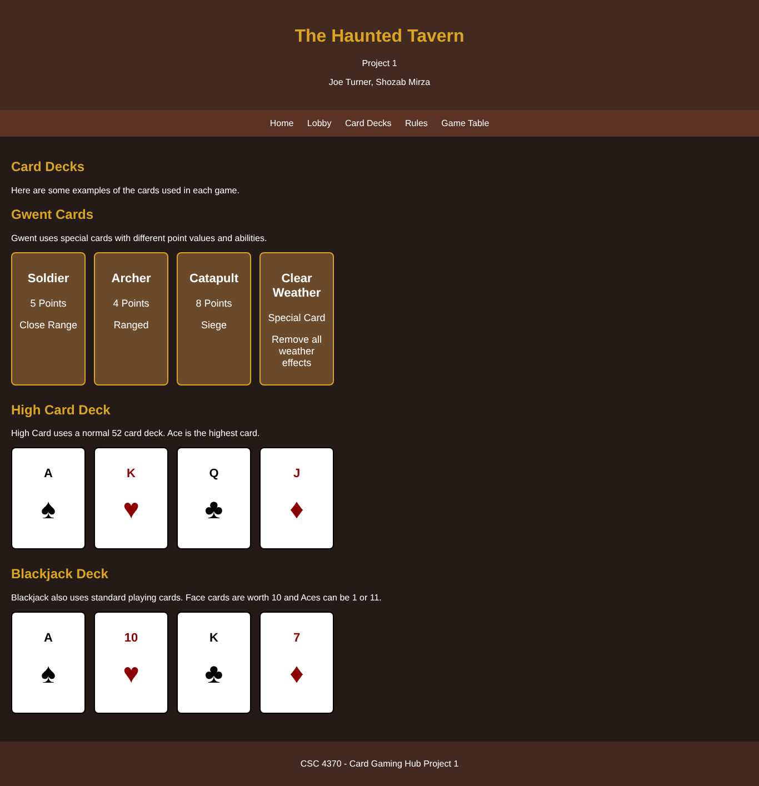
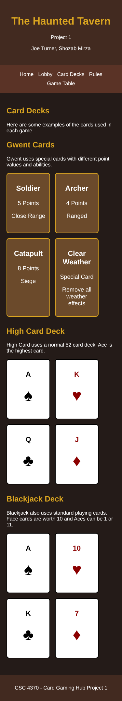
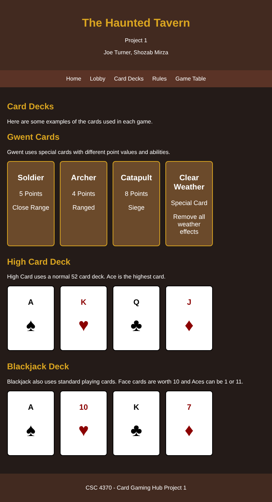
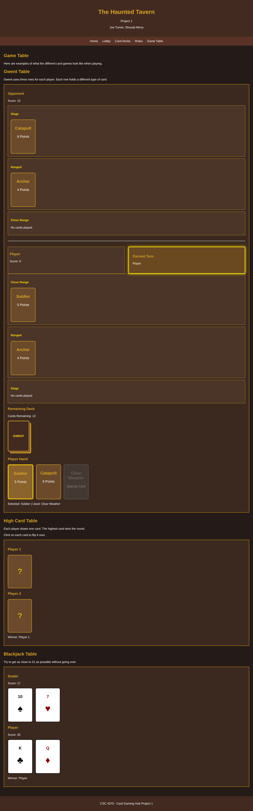
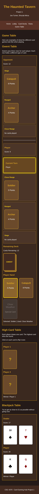
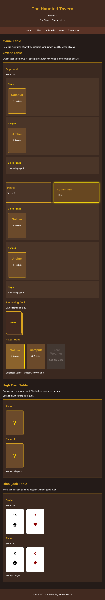
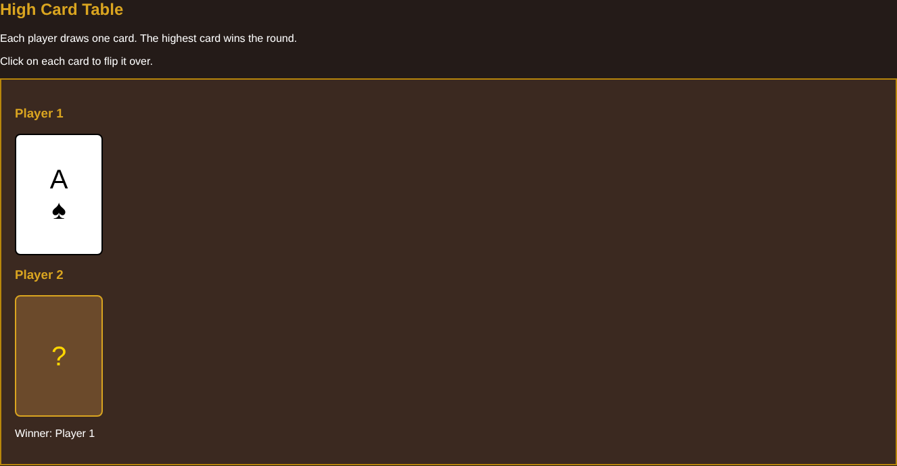
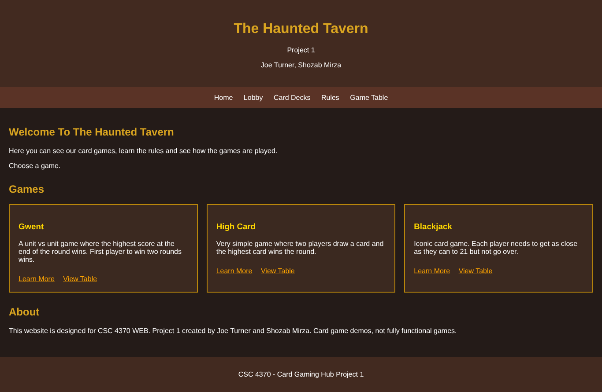

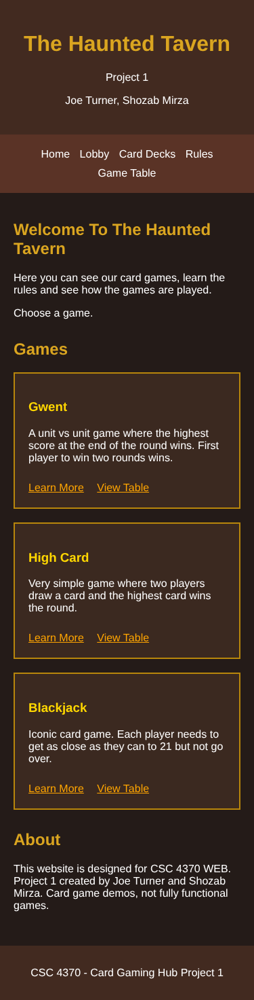
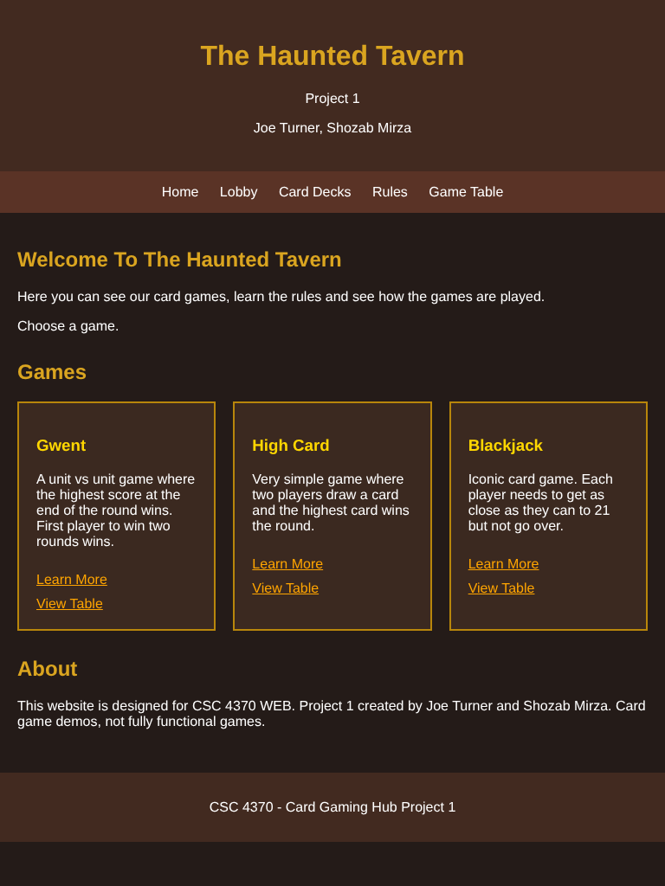
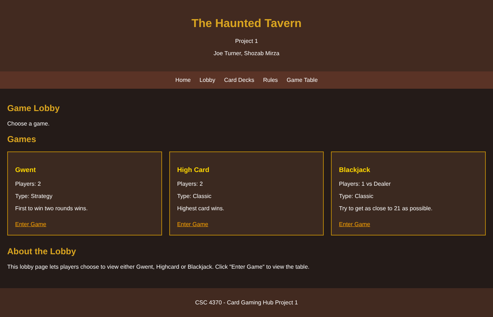
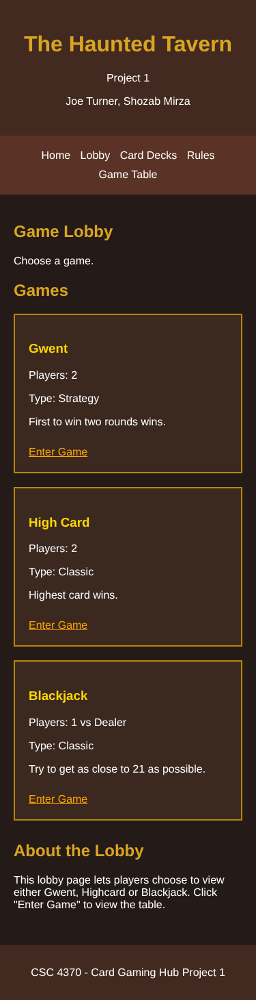
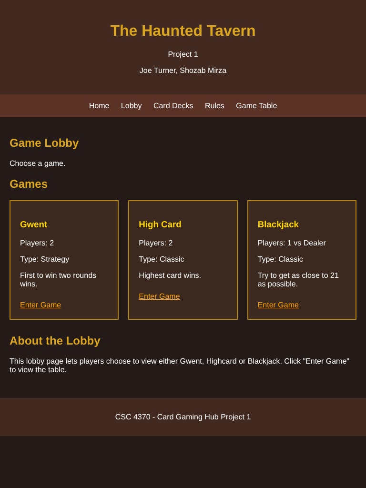
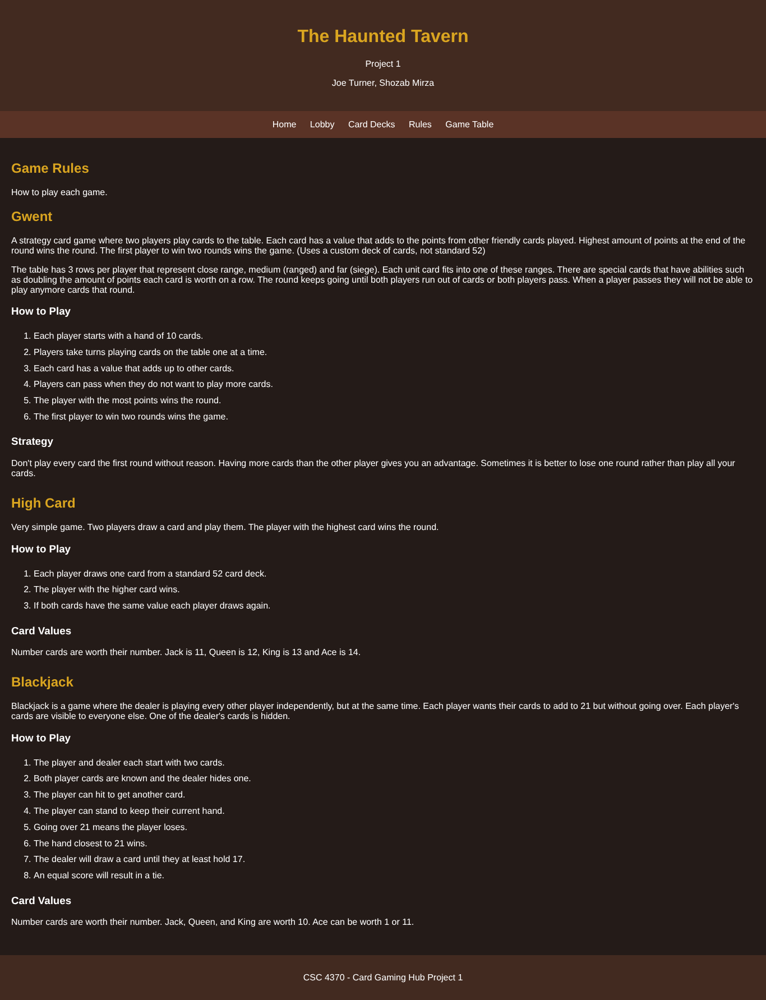
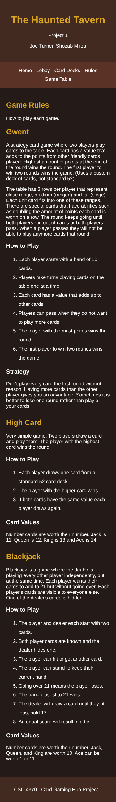
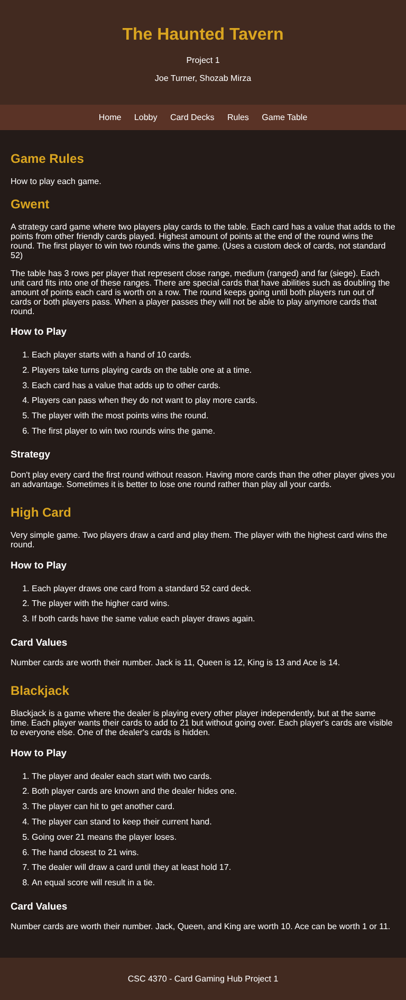