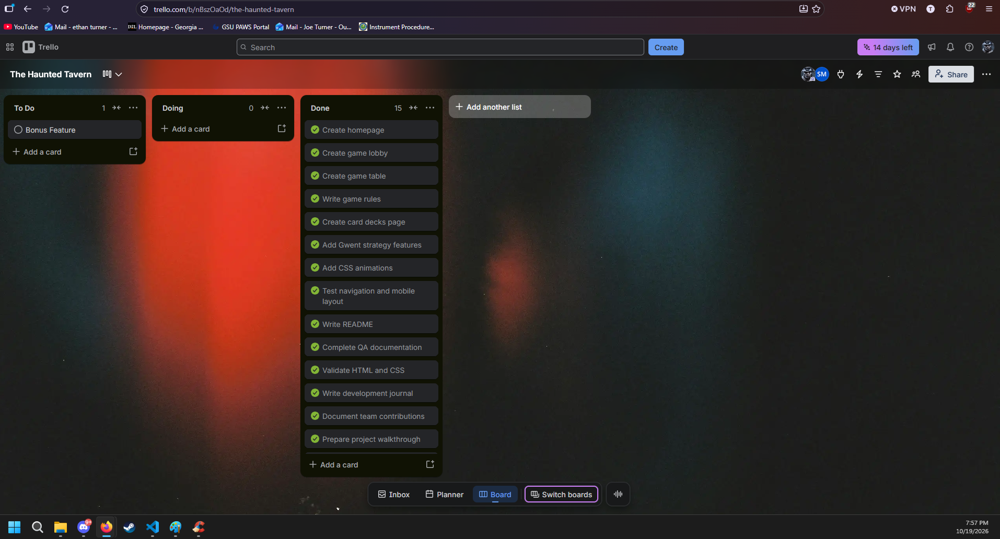

Project 1: Card Gaming Hub
The Haunted Tavern
CSC 4370 WEB
Team: Joe Turner, Shozab Mirza

Description:
This website shows 3 different card games. Gwent, a game card game created by the video game "The Witcher", Highcard and Blackjack. 
We used a medieval tavern theme inspired by The Witcher. By visiting the website you can view the card games, read on the rules, see examples of cards and rounds and see how the playing table would look. The games were originally meant to be playable but I dont think that is possible only using HTML and CSS, so we will give demonstration of the games instead. Everything was coded using HTML and CSS.

Pages
index.html: Homepage that links to other parts of the site and has preview information on the games
lobby.html: Allows the user to select a game
decks.html: Shows the cards of each game
rules.html: Explains the rules of each game
game.html: Shows the demo of the games, the table they are played on and card interaction

Features
Navigation buttons to all pages
card hover effects
Flipping animation on Highcard
Gwent table, the rows and score
Animated box for current turn element
Gwent, what card is selected animation and greyed out card for the one thats been used
Keyboard, press tab to switch between links and cards. Spacebar to interact/ flip card
Reduced motion support

Test
We tested the website to make sure each feature we added worked and that links worked. By testing we had to give up on a few features that we could not figure out how to add. We also showed the website to a couple friends and took their input on the flow and what confused them about navigation. This is why we made small about sections on the bottom. We also made the main navigation buttons useable on everypage instead of going back to home first. 
Our test included:
Navigation buttons for each page
Mobile testing
Multiple browser testing
Highcard flip animation
Current turn glow animation
Keyboard navigation
Reduced motion support activated by a accessibility within windows.
All 5 HTML files passed W3C validation. No errors.
style.css passed W3C validation. No errors.

AI:
AI was used for random questions and some syntax corrections. It also helped with some troubleshooting mainly being typos we kept looking over.  After not being able to figure out how to implement an actual playable game, AI told us its not possible only using HTML and CSS. This gave us a more definitive answer that we need to pivot our idea. 

Kanban:
We used trello to make keep up with task. During our standup meeting we would talk about what needed to be done and pick what we wanted to do. 

## Development Journal

[View Development Journal](journal.md)

## QA Testing

[View Development Journal](QA_Testing.md)

## Credits

[View Credits](CREDITS.md)